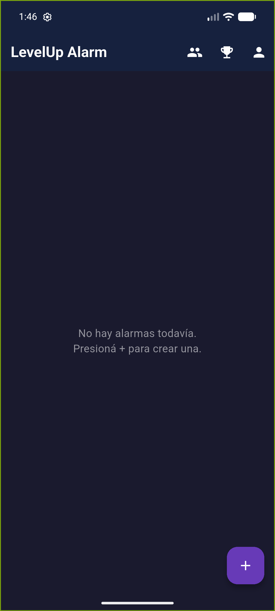
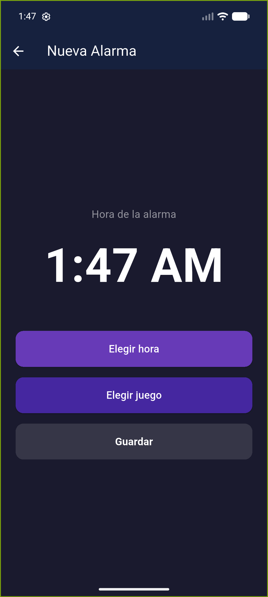
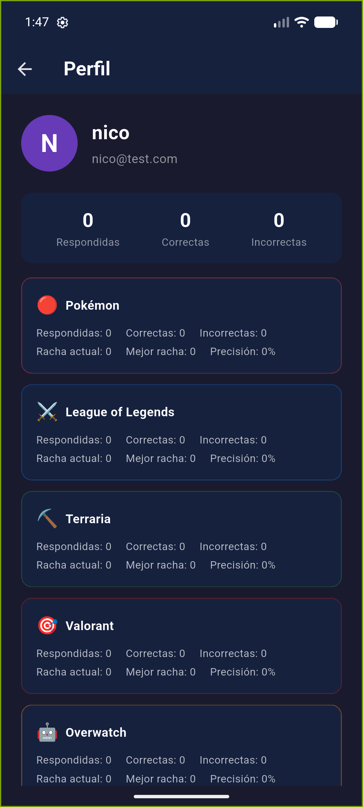
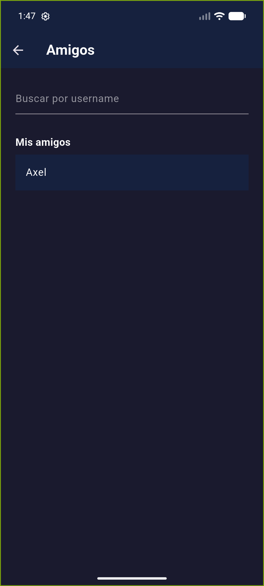
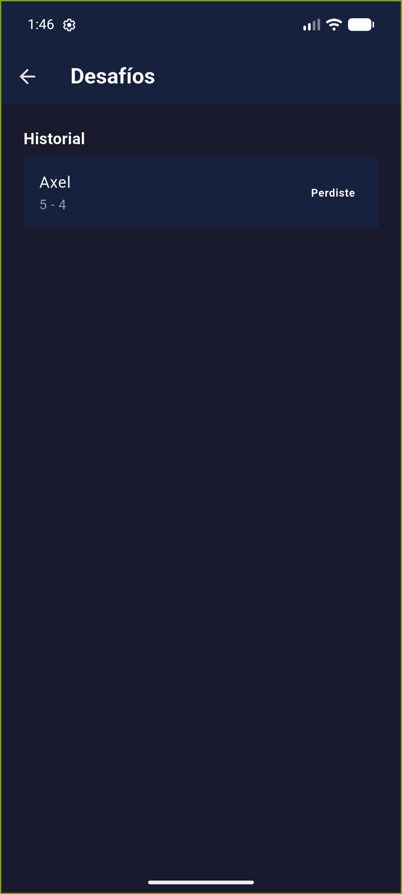

# LevelUp Alarm ⏰🎮

**An Android alarm that won't turn off until you prove you're awake: to silence it, you have to answer a trivia question about the video game you picked.**

On top of the alarms there is a full social layer: user accounts, cloud-synced stats, friends and asynchronous trivia challenges between players.

> **Status:** in development. The core (alarms, trivia, accounts, friends and challenges) is implemented and covered by tests. I paused it to finish my degree thesis and I plan to continue. It is not published on any store; run it from source (see [Run it](#run-it)).
>
> *Resumen en español al final.*

## Screenshots

| Home | New alarm | Profile & stats | Friends | Challenges |
|:---:|:---:|:---:|:---:|:---:|
|  |  |  |  |  |

## Features

**Alarms with trivia**
- Exact alarms that survive device reboots (`android_alarm_manager_plus` + full-screen notification).
- To dismiss the alarm you must answer a question from the chosen game; if you get it wrong, you get another one.
- 103 questions across 6 games: Pokémon, League of Legends, Terraria, Valorant, Overwatch and Warframe.
- Each game has its own visual theme (colors, icons).

**Social (Firebase)**
- Email/password sign-up and login, plus Google Sign-In.
- Profile with per-game stats stored in Firestore: answered, correct, current streak and best streak.
- Friends system: search by username, friend requests, and friends' profiles with their stats.
- Asynchronous challenges between friends: both answer the same frozen set of questions and whoever gets more right wins.

## Technical decisions

- **Alarms that fire while the phone sleeps.** Alarms are scheduled with `alarmClock: true` (Android's `setAlarmClock()`), which is exempt from Doze mode. With plain exact alarms (`setExact`), Android deferred the alarm when the screen was locked and the device was dozing, so it only rang once the phone was woken up.
- **Recurring alarms.** Each alarm re-arms itself from its callback, and the app reconciles all scheduled alarms on startup, so a missed callback or a reboot doesn't lose them.
- **Ringing experience.** Looping sound, wakelock and a full-screen screen over the lock screen, so the alarm can't be ignored.
- **Fair challenges.** When a challenge is created, its questions are frozen in the document, so both players answer exactly the same set.
- **Security rules.** Every Firestore request requires authentication, and writes are limited to the document owner or to the two participants of a friendship or challenge. Reads are open to any authenticated user (needed for username search). Tightening reads further is on the to-do list.
- **Testable by design.** All access to Firebase and the platform sits behind injectable services, so the logic is tested with doubles and no real network.

## Stack

| Layer | Technology |
|---|---|
| UI | Flutter (Material 3, custom animations) |
| State | `provider` (ChangeNotifier + ProxyProvider) |
| Backend | Firebase Auth + Cloud Firestore (auth-required security rules) |
| Alarms | `android_alarm_manager_plus`, `flutter_local_notifications` (full-screen intent) |
| Local storage | `shared_preferences` |
| Tests | `flutter_test`, `mocktail`, `fake_cloud_firestore`: 200+ automated tests |

## Architecture

```
lib/
├── models/      # Plain entities (Alarm, Question, GameStats, Challenge, ...)
├── services/    # Platform and data access (AuthService, ProfileService,
│                #   FriendsService, ChallengeService, AlarmScheduler, ...)
├── providers/   # Observable state (AuthProvider, AlarmProvider, ...)
├── screens/     # One UI file per screen
├── widgets/     # Reusable components (AuthGate, AnswerButton, ...)
├── data/        # Question bank per game
└── theme/       # AppTheme + a GameTheme per game
```

Principles the project follows:

- **Injectable services:** all Firebase/platform access lives behind a class that can be replaced in tests (`mocktail`, `fake_cloud_firestore`).
- **Infrastructure-free models:** entities don't import Firestore; (de)serialization lives in the services.
- **Strict TDD:** each feature was built with RED → GREEN → REFACTOR, and the full suite runs in seconds.
- **Spec-driven development:** every change starts from a proposal with specs and tasks before any code is written.

## Run it

Requirements: Flutter SDK, Android SDK (minSdk 26) and your own Firebase project.

```bash
git clone https://github.com/AxelMejias/LevelUp-Alarm.git
cd LevelUp-Alarm
flutter pub get

# Configure Firebase (generates lib/firebase_options.dart and google-services.json)
dart pub global activate flutterfire_cli
flutterfire configure

flutter run
```

> `android/app/google-services.json` is not in the repo: everyone uses their own Firebase project. In the Firebase console enable **Authentication** (Email/Password and Google) and **Cloud Firestore**. The security rules are in [`firestore.rules`](firestore.rules) and are deployed with `firebase deploy --only firestore:rules`.

## Tests

```bash
flutter test      # full suite
flutter analyze   # zero warnings
```

## Roadmap

- Tighten Firestore read rules for friend requests and challenges.
- More question banks and more games.
- Publish a first test build.

---

## Resumen en español

LevelUp Alarm es una app Android hecha con Flutter y Firebase: una alarma que no se apaga hasta que respondés bien una pregunta de trivia del videojuego que elegiste. Incluye cuentas de usuario, estadísticas en la nube, amigos y desafíos asincrónicos. Las alarmas se programan con `alarmClock` para que suenen aunque el teléfono esté dormido, y la lógica está cubierta por más de 200 tests con servicios inyectables y TDD. **Estado:** en desarrollo; la pausé para terminar la tesis y pienso retomarla.

---

Made by [Axel Mejías](https://github.com/AxelMejias) 🇦🇷
